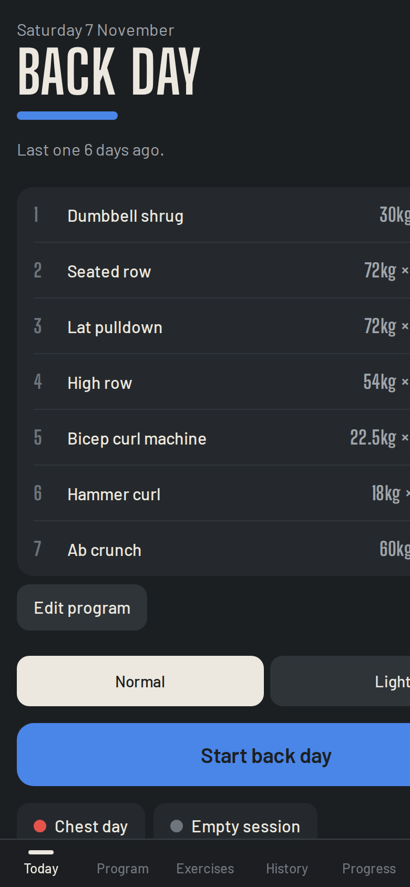
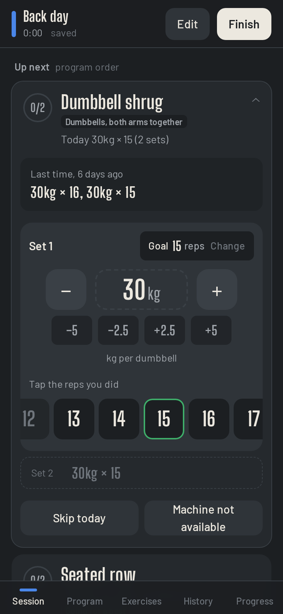
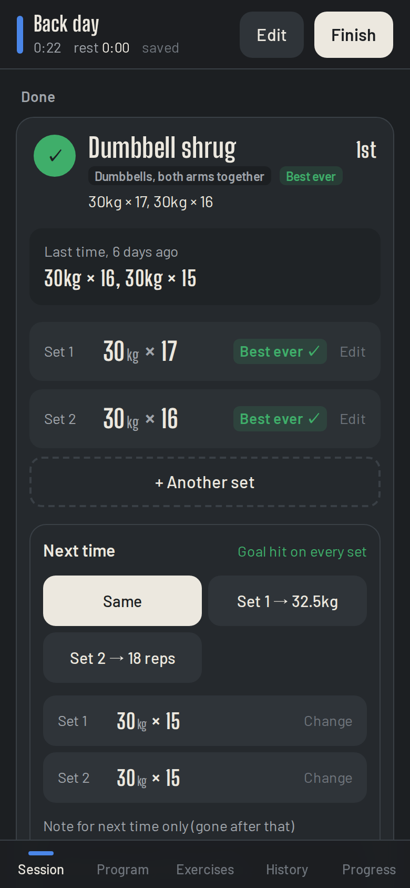
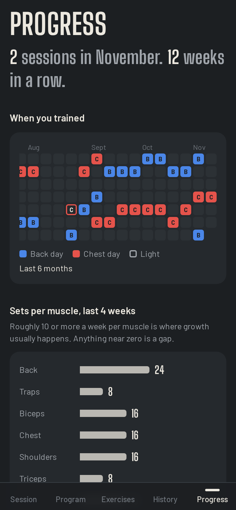

# Gym

> ⚡ Vibe coded: agents wrote it, I steered. Maintained to the standard of "works on my machine".

A personal gym log built to replace a messy phone note. It remembers what you did last time, fills in today, and turns "go up / stay / drop on the second" into a plan the next session picks up. Logging a set is one tap.

<p>
  
  
  
  
</p>

<sub>Screenshots use made-up demo data.</sub>

## Features

**Logging that stays out of the way**
- **One tap per set.** The weight is prefilled and you tap the reps you did. The rest timer starts on its own.
- **Steppers that fit the equipment.** Pin stacks move one plate at a time. Plate-loaded machines and free weights move by 0.5 kg, with ±2.5 and ±5 jumps.
- **Real order, kept separate from the plan.** Machine taken? Just open the next exercise. Done exercises stack on top in the order you actually did them. Next time, "Last time" tells you whether an exercise was done earlier or later than planned (fresher or more tired).
- **Rep goals, not ranges.** Hitting or beating the goal is green, one or two short is fine, and anything further short is flagged.
- **Works on flaky gym wifi.** Every tap is saved on the phone first and synced once the server is reachable.
- **Nothing is required.** Skip an exercise, or mark "Machine not available" so a broken machine isn't your fault in the log. Add a one-off exercise by just typing it in. Forgot to tap Finish? Set the real end time afterwards.

**Progression it does for you**
- **Next time defaults to the same.** Change it with one tap: set 1 heavier, then more reps on set 2, then set 2 heavier (back at set 1's rep goal, never past set 1's weight). Anything else can be set per set.
- **Max weight per machine.** Once a machine is at its top weight, the suggestions switch to reps, and the card shows "Maxed out".
- **Bests, set by set.** Set 2 is compared with earlier set 2s. A best means you hit the goal *and* went heavier or did more reps. A heavier set that missed the goal is an attempt, not a best.
- **"Going for a best".** When today's target would beat that set's best, the card says so before you lift.
- **Two kinds of note.** A note that stays with the exercise (seat position, form cue), and a note for next time only, shown once and then gone.

**Light days without the guilt**
- **Light sessions** for sick days, deloads and comebacks. Pick a weight % and a reps % of your normal targets. Light sessions count for the streak but stay out of records and charts, and they never move your weights.
- **Week streaks, not day streaks.** After 14+ days off, it suggests a light session.

**Progress**
- A six-month training calendar, sets per muscle over the last 4 weeks (gaps stand out), and a chart with the full history for each exercise.
- Rule-based tips: stalled lifts, gains this month, push/pull balance, when to go light.

**Setup**
- **Programs are just exercises in order** (back day, chest day, add your own). Weights and reps aren't part of a program: they carry over from the last session. Edit a program any time, even mid-session.
- **History is editable** after the fact, including the order things were done in.
- **Phone first:** add it to the home screen. It's responsive up to desktop.

## Run it

Needs Node 22+.

```bash
npm install
npm start          # builds the frontend, serves everything on http://127.0.0.1:5200
npm run dev        # Vite on :5203 with hot reload, API on :5200
```

`PORT` and `HOST` override the API address. `GYM_DATA` overrides the data folder.

The live version runs in a container at https://gym.bohdanmoroz.com, behind the shared login from the [hub](https://github.com/BohdanMoroz11/hub) repo.

## Data

- Everything lives in one file, `data/gym.json` (gitignored), with a daily copy in `data/backups/`.
- `npm run import -- [file] [--last YYYY-MM-DD] [--every 3] [--force]` imports an old plain-text log, e.g. `Incline 15x10, 12.5x13 (stay)`, with sessions separated by blank lines, newest first. Imported sessions are marked as rough: they set starting weights but don't count in stats.

See [AGENTS.md](AGENTS.md) for architecture and design rules.
